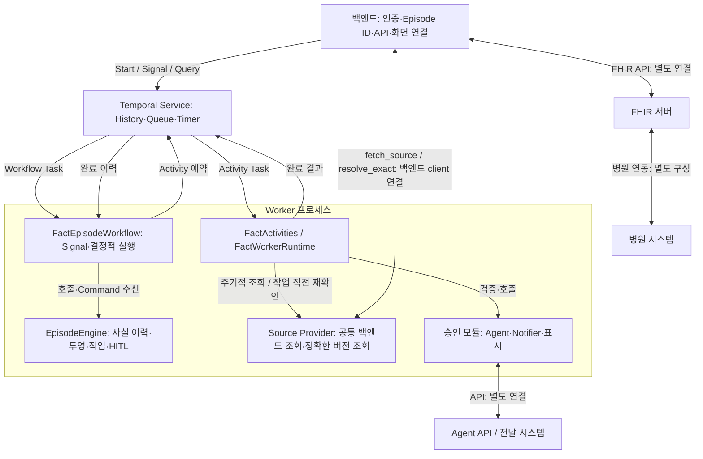

# CHAIN Orchestrator v0.4

CHAIN은 병원 기록·검사·의료진 결정 Event를 받아 유효한 사실을 관리하고,
그 사실에 연결된 Agent·HITL·알림 작업을 실행한다. 주 State와 마일스톤은 확보한 사실에서
계산한다. 작업은 주 State 이동과 독립적으로 계속 진행할 수 있다.

실행 엔진은 `chain/`, 합성 데모는 `demo/`에 있다.
현재 데모는 S0~S3와 경로 종료 분기를 다룬다. 입원·전원·EVT 전체 운영 규칙은 활성화하지 않았다.
제품 버전은 `0.4.0`이다. Event·Agent·Temporal 계약의 `/v1` 또는 `/v0.3` 표기는
각 데이터 형식의 버전이며 제품 버전과 별개다. 실행마다 설정·구현·Queue를 고정한다.

Screening·tPA는 입력 조건과 일치하는 합성 fixture를 사용하고 Summary는 요청 범위의 구조화 자료를 조합한다.
알림·EHR 표시는 `MOCK_RECORDED`다. 병원 API, 인증, HTTP/Push API와 프론트엔드는 별도 연결한다.

| 필요한 작업 | 안내 |
|---|---|
| 합성 Episode 직접 실행 | [데모 매뉴얼](demo/README.md) |
| 사실·State·작업 조건·타이머 작성 | [YAML 작성 안내](docs/usage/fact_authoring.md), [필드·문법 사전](docs/usage/fact_authoring_reference.md) |
| Episode 생성·Event·HITL 연결, 모듈 구현 | [연동 계약](docs/usage/fact_integration.md) |
| 알림 내용·수신처·백엔드 API 연결 | [Notifier 연결](#notifier-연결) |
| 실행 버전 보존·Worker 구성·신규 접수 전환 | [운영·Artifact 안내](docs/usage/fact_operations.md) |

## 설치와 데모 실행

Python 3.11 이상, 3.12를 권장한다. 저장소 루트에서 실행한다.

```sh
python3.12 -m venv .venv
.venv/bin/python -m pip install -r requirements.txt
```

Temporal Service 없이 흐름과 화면부터 확인:

```sh
.venv/bin/python -m demo --backend local --test-mode \
  --test-timer-scale 0.1 --test-poll-interval-s 1 --run-timeout 1800 \
  --output-dir "output/fact-local-interactive-$(date +%Y%m%d-%H%M%S)"
```

### Temporal CLI 경로 설정

데모가 임시 Temporal Service를 직접 시작하는 `--start-local` 실행에는 **설치된 Temporal CLI 실행 파일**이 필요하다.
`CHAIN_TEMPORAL_SERVER_PATH`는 그 실행 파일의 절대경로다. 폴더 경로나 Service 주소를 넣지 않는다.
데모는 CLI를 설치하거나 다운로드하지 않는다.

먼저 현재 터미널에서 설치 경로를 확인한다.

```sh
command -v temporal
```

아래 두 방법 중 현재 환경에 맞는 방법으로 설정한다. 경로가 출력되면 다음 명령을 사용한다.

```sh
export CHAIN_TEMPORAL_SERVER_PATH="$(command -v temporal)"
```

출력이 없으면 PATH에서 찾을 수 없는 상태다. 이미 설치한 실행 파일이 있다면 그 절대경로를 직접 지정한다.
**이 개발 컴퓨터에서 확인한 경로**는 아래와 같다. 다른 컴퓨터의 공통 설치 경로는 아니며,
`/tmp`의 임시 파일이 계속 존재한다고 가정하지 않는다. CLI 자체가 없는 환경은 설치 파일을 별도로 준비한다.

```sh
export CHAIN_TEMPORAL_SERVER_PATH=/tmp/temporal-sdk-python-1.31.0
```

설정 후 실행 파일과 버전을 확인한다.

```sh
"$CHAIN_TEMPORAL_SERVER_PATH" --version
```

버전이 출력되면 **같은 터미널에서** 다음 데모를 실행한다. `export` 설정은 현재 터미널 세션에 적용된다.
예시용 `/path/to/temporal`을 그대로 사용하면 실행 파일을 찾지 못한다.

### 임시 Temporal Service 데모

위 CLI 경로 설정을 완료한 뒤 실행한다. 실제 Service·Worker·Activity·Timer 연결을 확인한다.

```sh
.venv/bin/python -m demo --backend temporal --start-local --test-mode \
  --test-timer-scale 0.1 --test-poll-interval-s 1 --run-timeout 1800 \
  --output-dir "output/fact-temporal-interactive-$(date +%Y%m%d-%H%M%S)"
```

`--start-local`은 임시 in-memory Service를 시작하므로 운영용 영속 배포가 아니다.
`FileNotFoundError: Set CHAIN_TEMPORAL_SERVER_PATH ...`는 CLI 경로 확인 단계의 오류다.
이때의 `state=None`은 Workflow를 시작하기 전에 실패했음을 뜻한다.
출력 폴더는 실패 때도 생기므로 위 명령은 매 실행마다 시각을 붙여 새 경로를 사용한다.

### 기존 Temporal Service 데모

Temporal Service가 이미 동작 중이면 다음처럼 연결한다. 이 경우 CLI 실행 파일과
`CHAIN_TEMPORAL_SERVER_PATH`는 필요 없다. `localhost:7233`은 로컬 Service의 예시 주소이며,
다른 서버라면 실제 `호스트:포트`로 바꾼다.

```sh
.venv/bin/python -m demo --backend temporal --address localhost:7233 --test-mode \
  --test-timer-scale 0.1 --test-poll-interval-s 1 --run-timeout 1800 \
  --output-dir "output/fact-temporal-existing-$(date +%Y%m%d-%H%M%S)"
```

`--start-local`과 `--address`는 함께 사용하지 않는다. 데모는 두 경우 모두 전용 Worker를 함께 시작한다.
현재 데모의 기존 Service 연결은 기본 `default` namespace를 사용하며 namespace·TLS·API key 옵션은 제공하지 않는다.
별도 namespace나 인증이 필요한 통합 환경은 아래의 Service 연결 설정과 통합 Worker 안내를 따른다.

### 데모 조작

위 대화형 예제는 Clinical 타이머를 1/10로 줄이고 자료 조회 대기 간격을 1초로 설정한다.
10분 보류/재알림은 1분이 되며, 자료 반영은 조회·처리 시간에 따라 추가 지연될 수 있다.
두 옵션은 별개다. `--test-timer-scale`만 줄여도 자료 조회가 빨라지는 것은 아니다.
더 여유 있게 확인하려면 `--test-timer-scale 1`로 원래 임상 시간을 사용한다.
이 설정은 명시적 테스트 모드의 이번 실행 사본에만 적용한다. 원본 임상 시간과 기본 조회 주기 30초는 유지한다.
HITL 지연 타이머는 알림만 발생시키며 자동으로 승인·거부하거나 질문을 만료시키지 않는다.
DEFER/HOLD 타이머는 재질문을 요청하고, 기다리는 중에도 `ready`로 먼저 재질문할 수 있다.

HITL에서 결정·모의 역할·직원 ID·사유·확인사항을 입력한다.
일반 터미널에서는 타이머를 화면 하단 한 줄에서 갱신해 HITL 입력 영역과 분리한다.
IDE 실행창·파일·파이프 등 터미널 제어를 지원하지 않는 출력은 일반 로그 형식을 사용한다.
`docs`는 선택한 근거 개정의 원문, `json`은 판단 자료를 보여준다.
DEFER/HOLD는 타이머 재질문을 예약하고 보류 중 `ready`는 먼저 재질문을 요청한다.
관련 자료가 바뀌면 근거 개정을 확인한 뒤 다시 응답한다.
출력은 매번 새 경로를 사용한다. 단계·기록 응답·분기 실행은 데모 매뉴얼을 따른다.

## 실행 구조



엔진은 미래 시나리오와 기대 결과를 읽지 않는다. 데모의 가상 병원은 원천자료만 공개한다.
Source Provider가 공개된 자료를 조회해 변경을 발견하면 표준 Event를 내부 Ingress로 전달한다.
콘솔은 백엔드가 사용할 Signal·Query의 데모 화면이다.

## YAML 구성

| 파일 | 작성 내용 | 데모 예시 |
|---|---|---|
| Clinical | 사실·자료 범위·마일스톤·State 투영·작업·결정·임상 타이머 | [clinical.yaml](config/minimum/clinical.yaml) |
| Site | 출처 시스템·대상·정규 역할 선언 | [site.yaml](config/minimum/site.yaml) |
| Safety | 허용 작업·자료 범위·결정 역할·필수 확인 | [safety.yaml](config/minimum/safety.yaml) |
| Deployment | 설치 모듈 선택·버전·조회 주기·기술 timeout/retry 제한 | [deployment.yaml](config/minimum/deployment.yaml) |

Clinical의 `tasks`에서 실행할 Agent·mode·입력 Context를 선택한다.
Agent의 입출력 계약은 `module_metadata.json`에 선언하며,
구현 연결은 Deployment와 승인 설치 목록에서 지정한다.
`module_metadata.json`과 `installed.json`은 개발·배포 담당자가 관리한다.

지원 문법 안의 사실·마일스톤·State·작업 조건·타이머는 YAML로 구성한다.
새 Agent/API 구현에는 개별 모듈·입출력 검증·승인 목록·배포가 필요하다.
새 작업 종류나 조건 연산자에는 엔진 확장이 필요하다. 자연어 설명을 자동 실행하지 않는다.

설정 검사만 수행하는 명령:

```sh
.venv/bin/python -m chain config/minimum/clinical.yaml \
  --installations config/minimum/installed.json \
  --output-dir output/fact-config-check
```

`CONFIGURATION_VALIDATED`는 Workflow 실행 결과가 아니다.
설정은 새 실행을 만들 때 고정하며 파일을 수정해도 이미 시작한 실행의 규칙은 바뀌지 않는다.

## 원천자료 조회와 주기 설정

운영 조회 경로는 `CHAIN → 백엔드 → FHIR 서버`다.
병원 자료를 FHIR 서버에 반영하는 과정은 병원 연동에서 제공한다.
주기적 변경 확인과 Agent·HITL·알림·표시 작업의 직전 재확인은 같은
`BackendSourceProvider`와 백엔드 client의 `fetch_source(request)`를 사용한다.
조회 결과는 기존 Event 검증과 정확한 버전 조회를 거쳐 Context에 반영한다.
변경이 없는 조회만으로 새 사실이나 Agent 실행을 만들지 않는다.

**기본 조회 간격은 30초다.** 변경 위치는 사용하는 Deployment YAML의
`reconciliation.poll_interval_s`다. 기본 데모는
[config/minimum/deployment.yaml](config/minimum/deployment.yaml),
음성 Screening 프로필은 [deployment-negative.yaml](config/minimum/deployment-negative.yaml)을 사용한다.

```yaml
reconciliation:
  on_startup: true
  on_reconnect: true
  poll_interval_s: 30  # 조회 주기가 끝난 뒤 다음 조회까지 기다리는 초
```

0보다 큰 유한한 숫자로 지정한다. 한 Episode의 같은 출처에 대해서는 진행 중인 주기적 조회를
겹쳐 시작하지 않는다. 조회·반영에 걸린 시간은 위 대기시간에 추가된다.
작업 직전 재확인은 이 주기를 기다리지 않고 별도로 요청한다. 순차 작업은 다시 조회하고,
실제 병렬 준비 묶음에서만 결과를 공유한다. HITL을 기다리는 동안에도 주기적 조회는 계속하며,
Episode가 완료되면 종료한다.

값을 바꾼 뒤에는 변경한 설정으로 Worker와 새 Episode를 시작한다.
설정·Queue는 실행마다 고정되므로 이미 시작한 Episode에 파일 변경이 즉시 적용되지는 않는다.
이 값은 자료 조회를 위한 기술 설정이다. HITL 보류·재알림 시간은 Clinical YAML의 `timers`에서 정한다.

실제 연결에서는 백엔드 client의 `fetch_source(request)`와 `resolve_exact(event)`를 구현해
Worker의 `services["source_backend"]`로 제공한다. 공통 Provider와 반환 형식은
[backend_source.py](chain/backend_source.py), 연결 절차·필수 필드는
[원천자료 연동 계약](docs/usage/fact_integration.md#4-원천-시스템-adapter를-구현한다)을 참고한다.
현재 데모 client는 공개된 합성 저장소를 조회한다. 실제 FHIR API·인증·병원별 필드 변환은 별도 연결한다.
다수 환자의 호출량 제한과 실제 병원 API의 응답시간·부하는 운영 환경에서 확인해야 한다.
변경 조회 실패는 다음 주기에 다시 확인한다. 정확한 버전 조회가 재시도 한도를 모두 소진한 Event는
같은 자료를 재발견해도 자동 복구하지 않는다. 실패 감시와 재처리 한계는 [운영 안내](docs/usage/fact_operations.md#원천자료-조회-주기)에 정리했다.

## 콘솔 없는 연동

`chain.worker.create_worker()`로 모듈과 서비스 의존성을 주입하고,
`chain.client.start_episode()`로 Episode당 하나의 Workflow Execution을 시작한다.
`initial`은 파일명이 아니라 생성 요청의 JSON 객체다. 초기 식별 정보 8개만 전달한다.

### Temporal Service 연결 설정

백엔드와 Worker는 **미리 배포된 Temporal Service**에 Python SDK로 연결한다.
CHAIN의 백엔드/Worker 진입점은 Temporal CLI를 실행하거나 `CHAIN_TEMPORAL_SERVER_PATH`를 읽지 않는다.
CLI 경로는 데모의 임시 Service 시작에 쓰이며, 실제 연결에는 아래 설정이 필요하다.

| 설정 | 확인·연결 위치 |
|---|---|
| Service 주소 `호스트:포트` | 백엔드의 `Client.connect()`와 Worker의 `--address` |
| namespace | 백엔드의 `Client.connect(..., namespace=...)`와 Worker의 `--namespace` |
| 같은 실행 구성·Task Queue | 백엔드와 Worker가 같은 configuration 사용. Queue는 구성 hash로 자동 결정 |
| TLS·API key 등 인증 | 필요한 환경에서 SDK의 Client 초기화와 Worker bootstrap에 명시적으로 연결 |

주소와 namespace는 Clinical YAML의 임상 규칙과 별도의 배포 설정이다.
분리된 서버/컨테이너의 `localhost`는 각각 자기 환경을 가리키므로 실제 Service 주소를 지정한다.
Service를 운영하는 방식과 영속 저장소는 배포 환경에서 제공한다. 이 저장소가 운영 Service를 자동 배포하지는 않는다.

백엔드의 async 초기화/요청 처리에서 사용하는 SDK 호출 형태는 다음과 같다.
`configuration`·`initial`·`engine_run_id`는 애플리케이션이 준비한 값이다.

```python
from temporalio.client import Client
from chain.client import start_episode

# 애플리케이션 초기화에서 연결해 재사용한다. async 함수 안의 코드다.
client = await Client.connect("localhost:7233", namespace="default")
handle = await start_episode(client, configuration, initial, engine_run_id=engine_run_id)
```

Worker 프로세스도 같은 Service/namespace에 연결해 `create_worker()`와 `worker.run()`을 사용한다.
현재 [integration/worker.py](integration/worker.py)의 CLI는 `--address`·`--namespace`를 지원하며,
TLS/API key 인자는 제공하지 않는다. 보안 연결이 필요한 환경에서는 SDK의 `Client.connect()` 옵션을
애플리케이션과 Worker 초기화 코드에 추가해야 한다. API 자격정보를 임상 YAML이나 Workflow 입력에 넣지 않는다.
전체 Worker 명령과 private 서비스 주입은 [실행 연결 안내](docs/usage/fact_integration.md#실행-연결)를 따른다.

| 연결할 작업 | 확인할 코드 | 연결 방식 |
|---|---|---|
| 설정 준비·검사 | [configuration.py](chain/configuration.py) | 네 YAML·메타데이터·설치 증거 검증 |
| Worker 구성 | [worker.py](chain/worker.py), [worker_runtime.py](chain/worker_runtime.py) | `create_worker(..., services=...)`; API client·Store·receipt 저장소 제공 |
| Episode 생성 | [client.py](chain/client.py), [execution.py](chain/execution.py) | `start_episode(..., initial, engine_run_id=...)`; 고정 설정 Queue 사용 |
| 원천자료 조회·변경 발견 | [backend_source.py](chain/backend_source.py), [providers.py](demo/providers.py) | 공통 Provider에 백엔드 `fetch_source/resolve_exact` client 주입. 발견 자료는 같은 Ingress로 반영 |
| 수동 Event 입력 | [runtime_contracts.py](chain/runtime_contracts.py), [worker_runtime.py](chain/worker_runtime.py) | 이미 공개된 정확한 기록 버전을 `submit_event({source_id, event})`로 전달 |
| Agent 입출력 | [task_runtime.py](chain/task_runtime.py), [task_contracts.py](chain/task_contracts.py), [providers.py](demo/providers.py) | `NativeAgentProvider`, `invoke(request, snapshot, services)` 구현 |
| HITL·조회·재개 | [hitl.py](chain/hitl.py), [temporal_workflow.py](chain/temporal_workflow.py), [views.py](chain/views.py) | 진행 조회 `progress`, 개정별 근거 `hitl_view`, 전체 진단 `snapshot`, 변경 이력 `changes_since` |
| 알림 요청·전달 | [task_runtime.py](chain/task_runtime.py), [notifier.py](demo/mocks/notifier.py) | 아래 [Notifier 연결](#notifier-연결). 현재 `record()`는 Mock 기록만 수행 |
| EHR·대시보드 표시 | [worker_runtime.py](chain/worker_runtime.py), [effects.py](demo/mocks/effects.py) | 알림과 별도의 표시 Provider. 현재 Mock receipt 계약만 지원 |

원천 Context·Agent 입력 Snapshot·Summary 결과·HITL 근거 개정은 구분한다.
직전 조회 실패는 확보 자료와 `UNCONFIRMED`로 처리한다. 실행 중 바뀐 Agent 입력은 완료 후 최신 입력으로
재실행하고 구결과는 참고용으로 보존한다. HITL은 최신 근거 개정에만 응답할 수 있다.
실제 필수 필드와 호출 예시는 연동 계약에 정리했다.

통합 Worker의 서비스 주입 진입점은 [integration/worker.py](integration/worker.py)다.
애플리케이션이 제공하는 factory로 API client·저장소 등을 구성하며, 실행 명령과 함수 형식은 연동 계약을 따른다.

HTTP 서버·Push·인증은 제공하지 않는다. `actor.role`은 계약 검증용 문자열이며 인증을 대신하지 않는다.
Signal 전송 성공과 엔진 수락·적용은 다르므로 Query의 receipt와 처리 상태를 확인해야 한다.
화면의 반복 조회는 `progress`를 사용하고, 질문/근거 개정이 바뀌거나 원문을 열 때
`hitl_view(request_id, revision)`로 해당 개정만 조회한다. 경량 조회는 Agent 입력 Snapshot이 아니다.

### Agent 연결

개별 Agent는 `invoke(request, snapshot, services)`와 입력·출력 검증 함수를 구현한다.
이를 [NativeAgentProvider](chain/task_runtime.py)로 감싸 동기 `provider_factory(binding, services)`에서 반환한다.
현재 합성 구현은 [demo/providers.py](demo/providers.py)를 참고한다.

| 전달값 | Agent에서 사용하는 내용 |
|---|---|
| `request` | 실행 ID·Agent ID·버전·mode·입력 범위·선행 결과/확인 기록 ID |
| `snapshot` | 해당 작업에 허용된 Fact와 값·미확보/충돌 상태·출처 버전 |
| invoke의 `services` | 선행 결과·Summary Structured Context·직전 확인 기록·캐시를 제공하는 객체 |
| 반환값 | 선택한 mode의 `output_fields`와 개별 검증기에 맞는 Agent 결과 dict |

공통 Result 형식은 엔진이 구성한다. Agent가 성공 상태나 State 전이를 임의로 만들어 반환하지 않는다.
factory의 `services`는 API client 등을 주입하는 Worker 내부 dict이며, invoke의 `services` 객체와 구분한다.
Agent API client는 factory에서 받아 개별 모듈의 멤버나 closure로 연결한다.
Clinical에서 Agent·mode·Context를 선택하고, metadata에 입출력 계약을 선언한 뒤
Deployment의 구현 선택과 `installed.json`의 entrypoint·파일 hash·승인 정보를 맞춘다.
전체 필드·검증 예시는 [Agent 연동 계약](docs/usage/fact_integration.md#5-agent의-invoke와-개별-검증기를-연결한다)을 따른다.

### HITL 화면 연결

백엔드는 `progress`로 질문 ID와 최신 근거 개정을 확인하고,
`hitl_view(request_id, revision)`로 해당 화면에 필요한 근거를 받는다.
프론트엔드는 허용된 선택·확인사항·사유를 입력받고, 백엔드는 인증한 사용자 정보를 결합해
`submit_decision` Signal로 전달한다. 응답에는 질문 ID뿐 아니라 확인한 근거의 revision·ID·Snapshot ID를 포함한다.
입력 중 관련 근거가 갱신되면 최신 개정을 다시 보여주고 응답받는다.
DEFER/HOLD 뒤 먼저 재질문하려면 콘솔의 ready 대신 `request_hitl_resume` Signal을 사용한다.
전송 성공 뒤에도 receipt를 확인해야 한다. 필수 필드와 조회·응답 예시는
[HITL 연동 계약](docs/usage/fact_integration.md#6-hitl-화면과-응답을-연결한다)에 있다.

## Notifier 연결

운영 연동에서는 **CHAIN이 알림 시점·내용·수신 대상을 결정하고, 백엔드의 Notifier API가 전달을 수행한다.**
백엔드가 임상 규칙을 다시 해석해 알림 종류나 수신 대상 범위를 바꾸는 구조로 만들지 않는다.
현재는 알림 종류와 논리적 수신처를 선택해 Mock으로 기록하며, 본문 생성과 실제 API 전달 계약은 확장이 필요하다.

### 알림 정의 위치

| 정할 내용 | 수정·확인할 위치 | 현재 동작 |
|---|---|---|
| 어떤 사실·결정에 반응할지 | [clinical.yaml](config/minimum/clinical.yaml)의 `work_rules` | 알림 작업의 `when/stop_when` 평가 |
| 어떤 종류의 알림을 보낼지 | 같은 파일의 `tasks` | `kind: notify`, `template`, `recipient`, `context`, 반복 방식 선언 |
| 기관의 어느 대상에 연결할지 | [site.yaml](config/minimum/site.yaml)의 `recipients` | 논리적 수신처를 `channel/address_ref`에 연결. 현재는 Mock 주소 |
| 허용할 알림 종류 | [safety.yaml](config/minimum/safety.yaml)의 `notification_templates` | 허용된 알림 코드인지 검사 |
| 어떤 모듈로 전달할지 | [deployment.yaml](config/minimum/deployment.yaml)의 `notifier_binding`, `installed.json` | 승인된 Provider·지원 template/channel·구현 파일 선택 |

예를 들어 현재 CT 준비 알림은 `notify_CT_ROOM_CONFIRMED_L2` 작업이다.
Clinical의 조건은 HITL #1의 `PROCEED_TO_CT` 결정이며, 알림 종류는 `CT_ROOM_CONFIRMED_L2`,
수신처는 `CT_ROOM_BOARD`다. 작업 준비 직전 자료를 재확인한 뒤 조건을 다시 평가하고 Activity로 실행한다.
`template`은 알림 종류를 식별하는 코드다. 현재 YAML에는 메시지 본문 템플릿이나 치환 문법이 없다.
새 본문 필드를 임의로 추가하면 현재 Schema에서 거부한다.

### 현재 Notifier 입출력

실제 호출은 [LocalTaskRuntime.invoke_work()](chain/task_runtime.py)의
`notifier.record(request, recorded_at=...)`다. 아래는 현재 지원하는 요청 형식 예시다.

```json
{
  "request_schema": "chain-notification/v0.3",
  "request_id": "notify-demo-001",
  "episode_id": "EP-DEMO-001",
  "template": "CT_ROOM_CONFIRMED_L2",
  "channel": "CONSOLE",
  "recipient": "mock:CT_ROOM_BOARD"
}
```

실제 `request_id`는 엔진이 발급한 작업 `execution_id`를 사용한다.
현재 Provider에는 이 6개 필드만 전달한다. 엔진 내부 작업에 있는 Snapshot·환자/내원 ID·메시지 본문은 넘기지 않는다.
`SMS_GATEWAY`도 현행 Site에서는 `CONSOLE`에 연결되어 있어 실제 SMS가 나가지 않는다.

[MockNotifier.record()](demo/mocks/notifier.py)는 요청 ID·Episode·template/channel/recipient와
`receipt_schema/payload_hash/status/recorded_at`을 포함한 receipt를 반환하고 SQLite에 보관한다. `status`는 `MOCK_RECORDED`다.
같은 요청 ID·같은 내용은 기존 receipt를 반환하고, 같은 ID에 다른 내용은 거부한다.
엔진의 작업 성공은 이 Mock 기록이 성공했다는 의미이며 전달·수신 확인을 뜻하지 않는다.

### 운영 연동 요청 형식

다음은 **운영 연동을 위한 확장 예시이며 현재 코드가 지원하는 요청 형식은 아니다.**
필드명·HTTP 주소·처리 상태는 백엔드 API 계약으로 확정해야 한다.

```json
{
  "request_id": "notify-demo-001",
  "identity": {
    "site_id": "SITE-DEMO",
    "patient_id": "PAT-DEMO-001",
    "encounter_id": "ENC-DEMO-001",
    "episode_id": "EP-DEMO-001"
  },
  "notification_type": "CT_ROOM_CONFIRMED_L2",
  "message": {
    "title": "CT 준비 요청",
    "body": "Episode EP-DEMO-001의 CT 준비를 요청합니다."
  },
  "target": {"recipient_ref": "CT_ROOM_BOARD"},
  "basis_snapshot_id": "<알림 준비에 사용한 Snapshot ID>"
}
```

| 항목 | CHAIN이 정할 내용 | 백엔드가 연결할 내용 |
|---|---|---|
| 본문 | 선택한 알림 종류와 작업 Snapshot의 허용 항목으로 제목·본문 구성 | 지정된 내용을 병원 알림 시스템·프론트엔드로 전달 |
| 수신 대상 | CT실·간호 스테이션·해당 환자의 담당/당직 역할 등 목적에 맞는 대상을 지정 | 기관 주소록·당직표로 지정 대상의 실제 부서/직원 ID와 전달 주소 해석 |
| 환자·작업 | 환자/내원/Episode 식별과 요청 ID·근거 연결 | 동일 요청의 중복 접수·추적 관리 |
| 처리 결과 | 반환된 접수·전달·실패 상태를 계약대로 구분 | 실제 처리 단계와 해석한 수신 대상·메시지 추적 ID 반환 |

수신 대상과 발송 수단을 구분한다. 예를 들어 “신경과 당직자”는 대상이고 SMS는 발송 수단이다.
현재 `SMS_GATEWAY` 값만으로는 구체적인 의사나 당직자를 식별할 수 없다.
백엔드는 CHAIN이 지정한 대상의 주소를 해석하며, 다른 부서나 역할로 임의 대체하지 않는다.
특정 직원 ID까지 CHAIN에서 지정해야 하면 백엔드의 주소록/당직표 조회를 통해 확인한 뒤 요청에 고정한다.
해당 조회와 대상 계약은 현재 구현돼 있지 않다.

환자 정보가 필요한 본문은 CHAIN의 승인된 템플릿과 명시적인 치환 항목으로 구성한다.
필요 항목을 Clinical의 Context와 승인 범위에 선언하며, 미확보 값을 추측하거나 전체 Snapshot을 그대로 전송하지 않는다.
발송 직전에 백엔드가 임의로 최신 원천을 다시 읽어 이미 준비한 메시지의 의미를 바꾸지 않는다.
알림 전달은 `CHAIN → 백엔드 Notifier API → 병원 알림 시스템/화면` 경로이며 FHIR 조회와 별도로 연결한다.

### 구현 및 연결 절차

1. 알림별 제목·본문·필요 변수·수신 대상·반복 방식을 정의한다. CHAIN이 결정할 항목과 기관 주소록 매핑을 구분한다.
2. 요청·결과 계약을 확장한다. 본문·대상·식별자·근거를 담고, 접수 성공을 전달 완료나 수신 확인으로 처리하지 않는다.
3. Worker에서 호출할 실제 Notifier Provider를 구현한다. [demo/providers.py](demo/providers.py)의 factory와
   [MockNotifier](demo/mocks/notifier.py)를 호출 형태의 참고로 사용한다. API client·인증은 Worker 서비스로 주입한다.
4. 아래의 Mock 전용 변환·검증을 새 계약에 맞춘다. Provider 교체나 YAML 변경만으로 실제 API 연결이 끝나지 않는다.
5. Deployment와 설치 descriptor의 entrypoint·파일 hash·지원 template/channel을 맞추고 같은 구성의 Worker를 배포한다.
6. 내용·대상 일치, 미확보 정보, 잘못된 수신처, timeout, 같은 요청 ID의 재시도·중복 접수, 처리 상태를 시험한다.

| 확장할 코드 | 현재 제한 |
|---|---|
| [task_runtime.py](chain/task_runtime.py)의 `invoke_work()` | 6필드 요청으로 변환하고 `CONSOLE/LOG`, `MOCK_RECORDED`만 수용 |
| [tasks.py](chain/tasks.py)의 `_validate_receipt()` | 엔진도 같은 Mock receipt만 수용 |
| [task_contracts.py](chain/task_contracts.py), [Schema](chain/resources/authoring-v1.schema.json), [registry.py](chain/registry.py) | 새 입력·결과·설정 항목과 설치 모듈의 지원 범위 검증을 함께 맞춤 |

실제 API 접수·전달·수신 확인을 비동기로 반영할 전용 경로는 아직 없다.
동일 요청 ID와 동일 내용의 재시도에서 중복 발송을 막는 책임은 실제 백엔드에도 필요하다.
데모 SQLite를 그대로 사용할 필요는 없으며, 발송 시스템의 중복 방지·receipt 보관 계약으로 연결한다.
알림 취소 안내와 EHR 표시 해제는 각각 별도 작업이다. 기존 알림 기록을 삭제하거나 이미 보낸 문자를 회수한 것으로 처리하지 않는다.
세부 사항은 [알림·표시 연동 계약](docs/usage/fact_integration.md#7-알림과-ehr-표시를-구분한다)을 따른다.

## 저장소와 운영 경계

엔진의 자체 PostgreSQL은 없다. Temporal Service의 영속 저장소는 별도 배포 구성이다.
데모의 SQLite는 알림·표시 Mock의 receipt를 보관한다.
병원 API·공유 원천 버전 보관·외부 전달 receipt 저장소는 운영 연결 시 제공한다.

현재 Snapshot과 원문 일부는 Workflow 상태·History에 포함된다.
민감정보 관리, 장기 History 용량, 상세 조회 분리와 외부 참조 저장은 운영 통합 범위다.
실제 병원 API·인증·OS 장애 복구·장기 부하와 사람의 직접 데모 수용은 확인되지 않았다.
새 경로의 존재가 운영 신규 접수 전환을 뜻하지는 않는다. 버전 보존과 전환은 운영 안내를 따른다.
Local·실제 Temporal·History Replay는 각각 검증한다. 자동 시험과 사람의 직접 수용,
정상 Worker 교체와 OS 강제 종료 복구를 구분한다. 운영 신규 접수 전환은 별도 절차다.
